# Amount in Words (English & Bangla) — User Manual

Module: `number_to_words` &nbsp;|&nbsp; Odoo 19.0 &nbsp;|&nbsp; Version 19.0.1.0.0

## 1. What it does
Shows a number or a money amount **in words**, in English or Bangla, on any form view
and on any printed (PDF) report. You decide *which model*, *which field* and *where*.

| Input | English | বাংলা |
|---|---|---|
| 12,345,678 | Twelve Million Three Hundred Forty-Five Thousand Six Hundred Seventy-Eight | এক কোটি তেইশ লক্ষ পঁয়তাল্লিশ হাজার ছয় শত আটাত্তর |
| 12.34 | Twelve Point Three Four | বারো দশমিক তিন চার |
| 150.50 BDT | One Hundred Fifty Taka and Fifty Paisa | এক শত পঞ্চাশ টাকা এবং পঞ্চাশ পয়সা |

## 2. Requirements and installation
* Odoo 19.0 (Community or Enterprise). No external Python package is needed.
* Copy the module folder `number_to_words` into one of your addons paths.
* Restart Odoo, enable developer mode, **Apps → Update Apps List**, then install
  **Amount in Words (English & Bangla)**.
* To upgrade: replace the folder, restart, then `-u number_to_words` or click *Upgrade* in Apps.

## 3. Languages
There is nothing to set up. The words are written in the language of the user, or in the one you choose in the Settings.

| | Languages | How |
|---|---|---|
| **Built in** | English, Bangla (বাংলা), Hindi (हिन्दी), Urdu (اردو) | Words, scales (hundred, thousand, lakh, crore...) and common currency names come with the module. Hindi and Urdu are not available in Odoo's own library, so they are included. |
| **Automatic** | Spanish, Arabic, French, German, Portuguese, Russian, Italian, Turkish, Indonesian, Japanese, Korean, Vietnamese, Persian, Hebrew, Dutch, Polish, Ukrainian, Thai, Romanian and about 30 more | Written by the library that Odoo itself uses for its "amount in letters" (`num2words`): nothing to install or configure. |
| **Not available** | Chinese, Tamil, Bengali (India)... | A language that neither the module nor the library supports is written in English. |

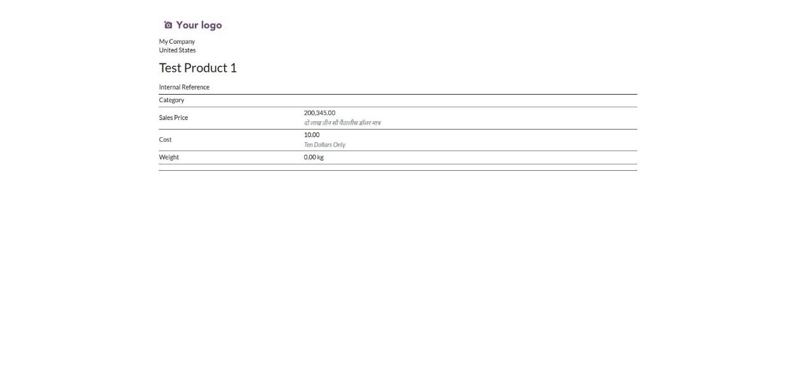

Notes
* **A Spanish user sees Spanish, a Hindi user sees Hindi**, on every rule, widget and report, without any rule per language.
  To always use one language, choose it in **Settings → Language** (English, Bangla, Hindi or Urdu), or on a rule line.
* **Amounts in the automatic languages** are written like Odoo's own amount in letters: the language must be installed
  in Odoo (Settings → Languages), and the name of the currency is the translated name of the currency in Odoo.
  The "Only" word and the Bangla/Hindi/Urdu subunit names exist only for the built-in languages.
* A language is chosen from the code of the Odoo language of the user (`es_ES` → Spanish, `hi_IN` → Hindi).

## 4. Settings
Open **Amount in Words → Settings** (administrators only).

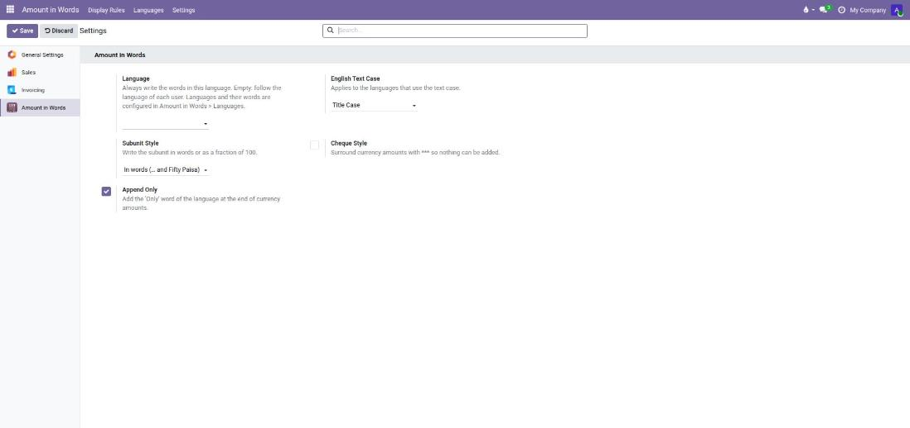

| Setting | Meaning |
|---|---|
| Language | Always write in this language (English, Bangla, Hindi or Urdu). Empty: follow the language of each user, in any language Odoo supports. |
| English Text Case | Title Case, lower case or UPPER CASE (for the languages that use the text case). |
| Subunit Style | "… and Fifty Paisa" or "… and 50/100". |
| Cheque Style | Surrounds amounts with `***` so nothing can be added. |
| Append Only | Adds the "Only" word of the language after currency amounts. |


## 5. Display Rules — choose where the words appear
Open **Amount in Words → Display Rules**. One rule covers one model; each **line** is one field.

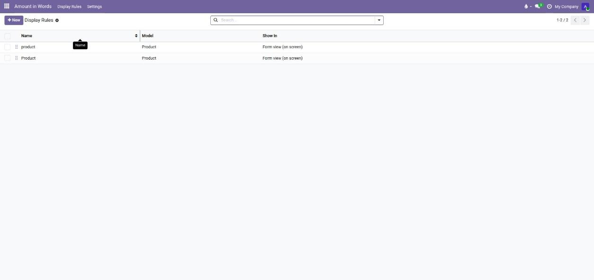

### Switch a rule on or off
Every rule has an **Active** toggle, in the list and on the form. Switch it off and the rule stops writing its
words at once (on screen and on the PDF); switch it on and they are back. Nothing is deleted. Inactive rules stay
in the list, greyed out; use the **Active / Inactive** filters to find them.

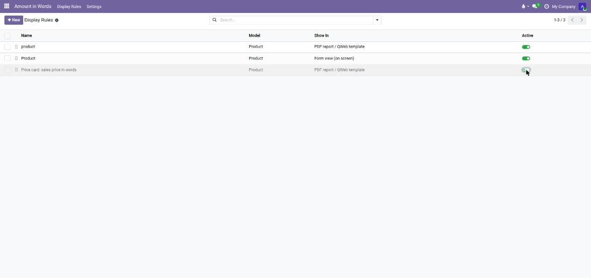

### 5.1 Show the words on a form (on screen)
1. Click **New**, give the rule a name.
2. **Model**: for example *Product* or *Sales Order*.
3. **Show In**: *Form view (on screen)*. The **Form View** is chosen for you; change it if needed.
4. In the **Fields** tab click *Add a line*. A dialog opens (click a line later to edit it in the same dialog;
   *Save & New* adds several lines quickly). For every number you want in words:
   * **Number Field**: the numeric field (float, monetary or integer).
   * **Mode**: *Currency amount* (unit and subunit) or *Plain number* (decimals read digit by digit).
   * **Currency Field**: empty means the model's `currency_id`.
   * **Language**: empty (settings, then the user's language) or any configured language.
   * **Place Next To**: a field that is visible on that form.
   * **Position**: before or after that field.
5. Save. Open a record: the words appear (in grey italics) at the chosen place.

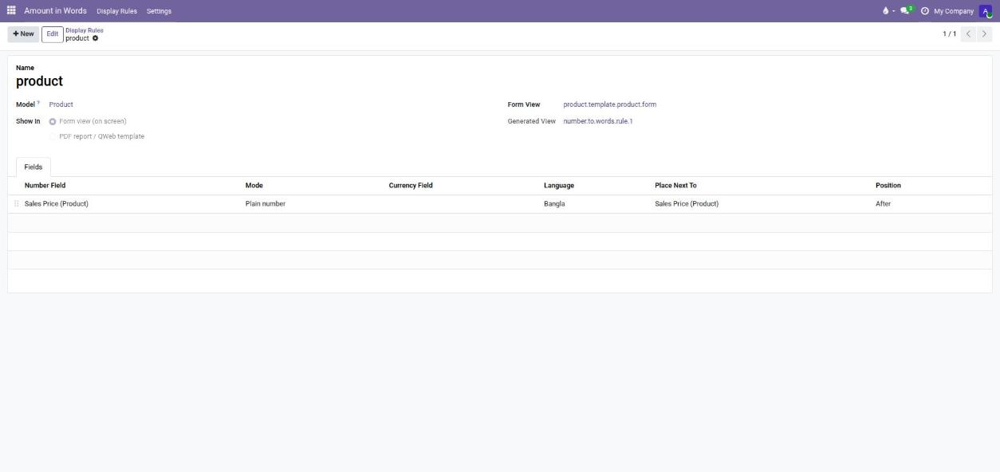

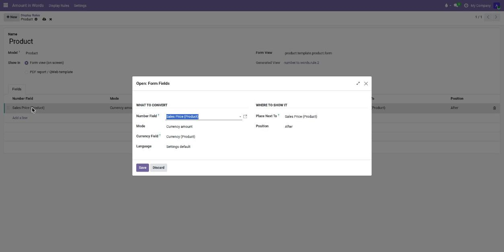

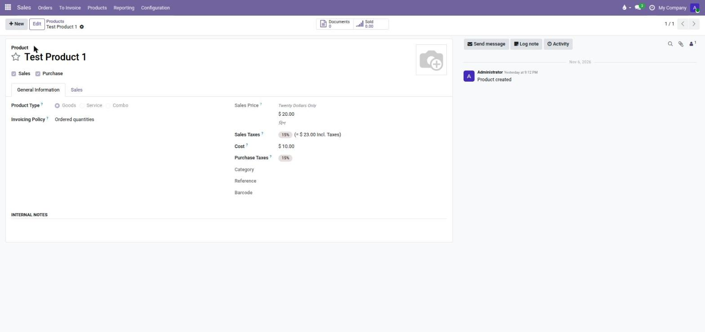

Tips
* **Each "Show In" choice keeps its own lines.** The form lines and the PDF lines are two separate lists on the same rule:
  switching between them, or changing the report, never deletes anything.
* **Place Next To** on a form only offers the fields that are displayed on that form, so every choice shows.
* Several lines can use the same anchor; they keep the order of the lines.
* Archive a rule to hide its words, delete a line or the rule to remove them.
* If you choose a "Place Next To" field that is not on the form, Odoo tells you so when you save.

### 5.2 Show the words on a PDF report
No technical knowledge is needed: you pick the place from a list.
1. New rule, choose the **Model**, set **Show In** to *PDF report / QWeb template*.
2. **Report**: only the printed reports of the chosen model are listed (for Product: the product labels).
3. **Report Template** and **Record Variable** are filled in for you. Change them only if you know the report is built differently.
4. In the **Fields** tab click *Add a line*. In the dialog choose the number field, then **Place Next To**.
   The list describes the report in plain words (type a few letters, for example *total*, to search it). For example:
   * *Field: Customer*, or *Field: Customer › Tax ID*, a value printed by the report
   * *Column: Quantity*, a column of a table
   * *Title: Order Overview*, a heading
   * *Block: so total summary*, a named part such as the totals
   Choose *After* or *Before* and save.
   Only places of the document itself are listed: what is repeated for every order line is left out.
   Choose the report that matches what you print: the product labels, for example, exist in several formats
   (Dymo, 2x7, 4x7, 4x12) and each format shows different fields. The list only offers the places of the chosen
   report, and a place found in several formats of the same report works for all of them.
5. Print the report: the words appear at that place. The list follows the report into the templates it calls,
   so it also works for reports that are assembled from several templates.

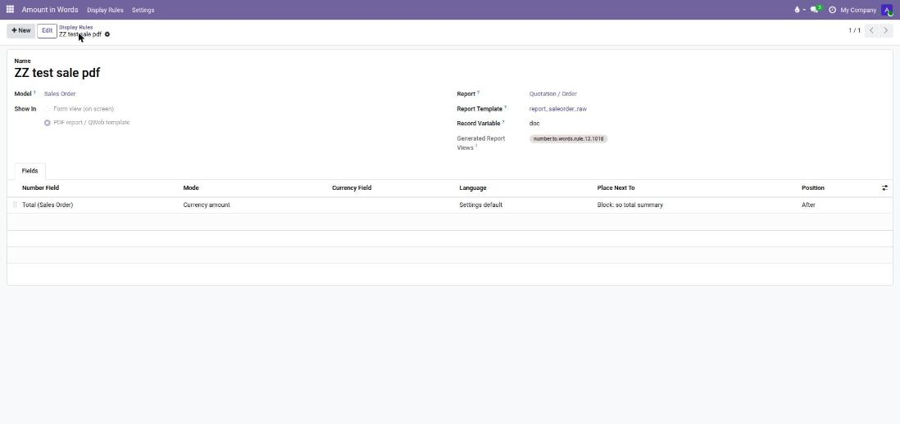

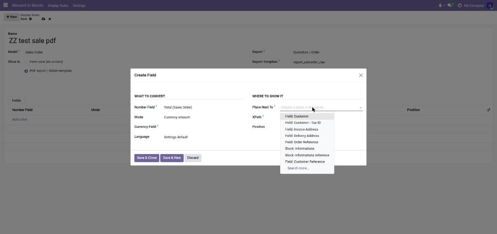

The result on the printed quotation, in Bangla (Settings → Language → Always Bangla):

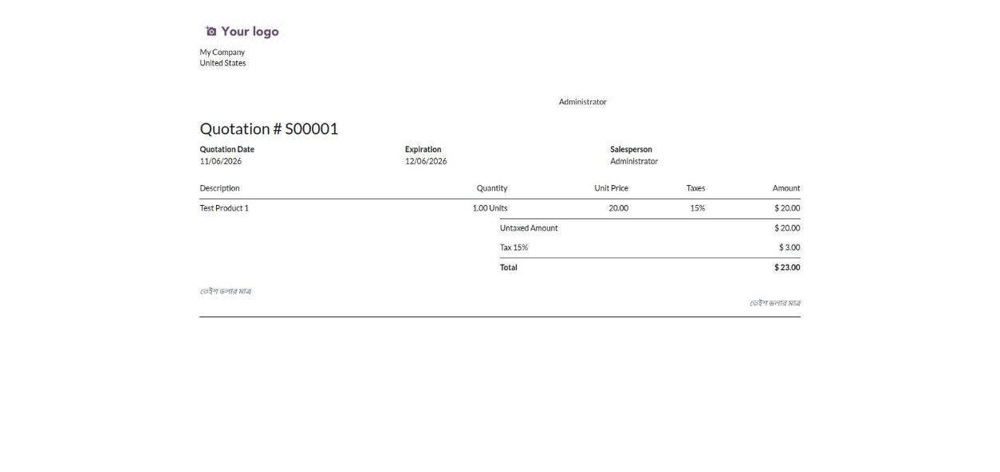

Developers can see (and edit) the technical *XPath* of a place in developer mode.

## 6. Example: the total in words on quotations (any model works the same way)
The module has no code for Sales, Purchase or any other app: **you** tell it where to write the words.
For the total of a quotation, on screen and on the PDF:
1. **Display Rules → New**, Model *Sales Order*, **Show In**: *Form view*. Add a line: Number Field *Total*,
   Place Next To *Tax Totals*, *After*. Save.
2. **Display Rules → New**, Model *Sales Order*, **Show In**: *PDF report*, Report *Quotation / Order*. Add a line:
   Number Field *Total*, Place Next To *Block: so total summary*, *After*. Save.

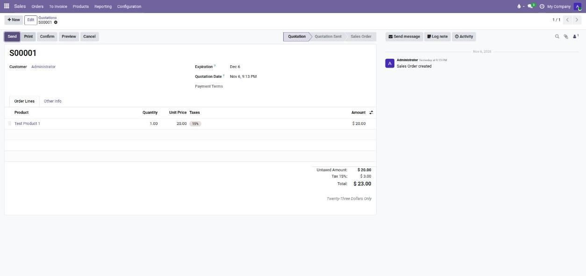


The same two rules, with another model, work for purchase orders, invoices, deliveries, payslips, products...
any model that has an integer, float or monetary field.

## 7. Invoices and checks
Odoo already prints "amount in letters" on invoices (*Invoicing → Settings → Total amount of
invoice in letters*) and on checks. When you choose Bangla, a forced language or the lakh/crore
system, those documents use this module automatically.

## 8. For developers
```python
# Python
self.env['number.to.words'].to_words(150.5, lang='bn', mode='currency', currency_id=currency.id)
```
```xml
<!-- QWeb -->
<span t-out="env['number.to.words'].to_words(o.amount_total, mode='currency', currency_id=o.currency_id.id)"/>
```
```xml
<!-- Field widget (words only, or number plus words) -->
<field name="amount_total" widget="number_to_words"
       options="{'mode': 'currency', 'lang': 'bn', 'words_only': True}"/>
```
`to_words(value, lang=None, mode='number', currency_id=None)` returns `''` for empty or invalid values. `lang` is the **code** of a configured language (`'en'`, `'bn'`, `'hi'`...). A language that cannot write a number (a missing word or scale) raises a clear error that says what to add.
`mode` is `'number'` or `'currency'`.

## 9. Troubleshooting
| Problem | Solution |
|---|---|
| The menu or new fields are missing | Restart Odoo and upgrade the module, then refresh the browser (Ctrl+Shift+R). |
| "The field … is not displayed in the form view" | Choose a "Place Next To" field that is on that form. |
| The words do not appear on the printed report | Check that the rule's **Report** is the one you print (for example *Product Label 2x7*, not *Dymo*), and that the place is one of that report's places. |
| "The place … does not belong to the report" | You changed the report after choosing the place. Open the line and choose the place again. |
| "The place … was not found in the report template" | The report changed since the line was created. Open the line and choose the place again. |
| English instead of the language I expect | Check the language of the user, *Settings → Language* and the line's Language. The language must be one of the built-in ones or one supported by `num2words`; otherwise English is used. |

## 10. Support
Questions and bug reports: use the support section of the module page on the Odoo Apps store.
Please include the Odoo version, the module version and what you did.
